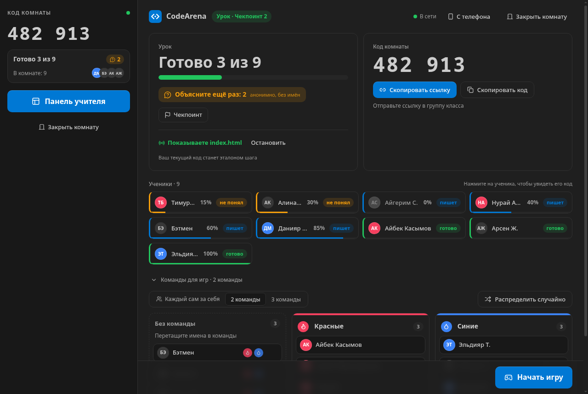

# CodeArena

**Kahoot + Codewars inside VS Code.** The teacher creates a room, students join with a 6-digit code or a link, and the whole class plays coding games right in the editor — tug of war, quiz, Codewars, race and find-the-bug.

Open source (MIT), zero cost: students' code runs on their own machines, the game server runs on Cloudflare's free plan.

Made by [**q-werty452**](https://github.com/q-werty452).



**Install:** search for **CodeArena** in the VS Code Extensions view (Visual Studio Marketplace, or Open VSX for VSCodium / Cursor),
or download the `.vsix` from [Releases](https://github.com/q-werty452/codearena/releases) → *Extensions: Install from VSIX…*

Everything from the [spec](docs/TZ.pdf) is in: **Lesson mode** (the default), **Quiz**, **Tug of war**, **Codewars**, **Race**,
**Find the bug**, task bank, your own tasks and AI generation, anti-cheat, live teacher table and CSV export. See the [roadmap](docs/ROADMAP.md).

Built for frontend teachers: **HTML/CSS → JavaScript → Python**. HTML and CSS are checked with selector rules (“there is a `<footer>`”, “every `img` has `alt`”, “`.card` has `display: flex`”), JavaScript and Python with test calls — all on the student's computer. Django/DRF and Flutter snippets are supported in Quiz and Find the bug (no code execution).

## Repository layout

| Package | What's inside | Stack |
|---|---|---|
| [`packages/extension`](packages/extension) | VS Code extension: sidebar, game panel, join links, running tests, anti-cheat | TypeScript, VS Code API, esbuild |
| [`packages/webview-ui`](packages/webview-ui) | All game UI inside VS Code (student and teacher panels) | React, Vite, Tailwind CSS, Motion |
| [`packages/server`](packages/server) | Rooms, players, teams, scores, timers, answer checking | Cloudflare Workers, Durable Objects (SQLite), WebSocket Hibernation |
| [`packages/shared`](packages/shared) | Message protocol, task schemas, scoring logic | TypeScript, Zod |
| [`tasks/`](tasks) | Open task bank: 737 tasks in HTML/CSS, JavaScript, Python and Dart for every game (basic, medium, hard), validated by tests — send yours as a pull request | JSON |

## Development

Requires Node.js 22+ and VS Code.

```sh
npm install
npm test                 # shared logic, server (inside workerd), runners, task bank
npm run e2e -w codearena # drives a real VS Code instance (needs npm run dev:server)
npm run typecheck

npm run dev:server       # local game server on http://127.0.0.1:8787
npm run dev:ui           # design-system gallery on http://127.0.0.1:5173

npm run build            # builds webview UI into the extension, then the extension
```

To try the extension: open this folder in VS Code and run **Run Extension** (F5), or build a `.vsix`:

```sh
npm run build && npm run package -w codearena
```

then in VS Code: *Extensions → … → Install from VSIX*.

## Your own tasks

Teachers can bring their own tasks — **Choose a game → My tasks**:

- **Import a file** — `.json` (a CodeArena set or any similar list), `.txt` / `.md`, or **Word `.docx`**.
- **Paste text** — copy questions from a doc or a test.
- **Generate with AI** — see below.

Every task is sorted into the game it fits: options → *Quiz*, short answer → *Tug of war*,
code with tests/rules → *Codewars*, find the line / best variant / fix the bug → *Find the bug*
(*Race* takes quiz, tug and code tasks). Imported sets are kept in this VS Code and appear in
every game's task bank under *My tasks*.

Text format (Word numbered lists work too — a **bold** option is the right one):

```text
# Topic: Links

1. Which tag creates a link?
- <div>
+ <a>
- <span>

2. Which tag makes a paragraph?
a) <br>
b) <p>
Answer: b

3. Which attribute holds the link address?
= href
```

Questions that can't be read (no right answer marked, more than 4 options…) are listed with the reason.

### AI tasks (Gemini)

The teacher uses their own free key from [Google AI Studio](https://aistudio.google.com/apikey); it is stored
in VS Code's SecretStorage and sent only to the Gemini API (in a header). Pick a game, language, topic and
count — or paste lesson notes. A file that isn't in a known format can be **read with AI** too.
Every code task is verified locally: the reference solution must pass all tests/rules and the starter
(or buggy code) must fail; broken tasks get one repair round, the rest are dropped.
The model is the newest stable `gemini-*-flash` available to the key (`codearena.ai.model` to override).

## Releases

`git tag v0.1.0 && git push --tags` runs [`.github/workflows/release.yml`](.github/workflows/release.yml): tests, `.vsix`,
publishing to the Visual Studio Marketplace (Trusted Publishing, no stored token), Open VSX (`OVSX_PAT` secret) and a GitHub Release.
The version in `packages/extension/package.json` must match the tag.

## Server

The extension uses the free public server **https://codearena.codearena-server.workers.dev** (Cloudflare Workers free plan:
students' code never runs there, it only keeps rooms, scores and timers). Per-IP rate limits protect the free quota.

### Self-hosting

A school can run its own copy on its own free Cloudflare account:

```sh
cd packages/server
npx wrangler login
npx wrangler deploy
```

Then set **CodeArena: Server Url** (`codearena.serverUrl`) in VS Code to your worker's URL.

## Design principles

1. One main action per screen.
2. Understandable in 5 seconds without instructions.
3. Instant feedback on every action.
4. Native to VS Code: base colors come from the user's theme, bright colors only for game elements.
5. Not only color: teams and answers also differ by shape or icon.
6. No browser-default ugliness — every element is styled.

## License

[MIT](LICENSE) © q-werty452
