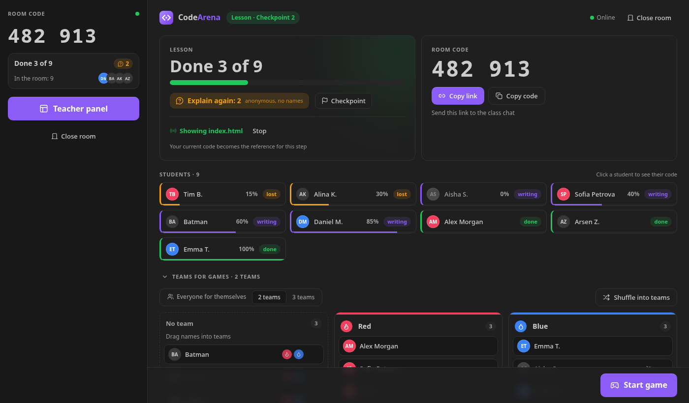
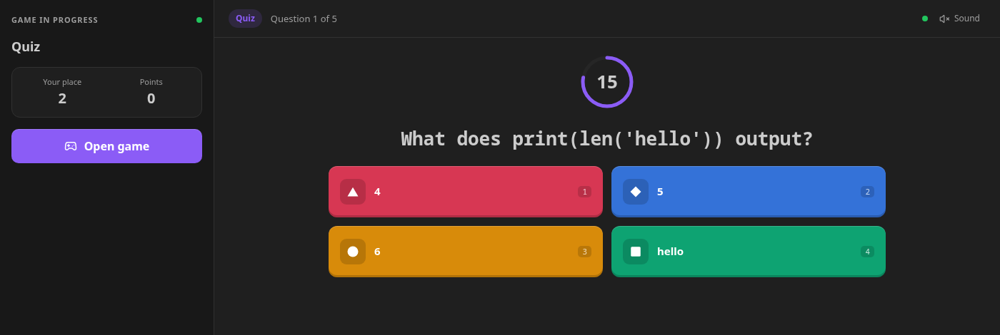
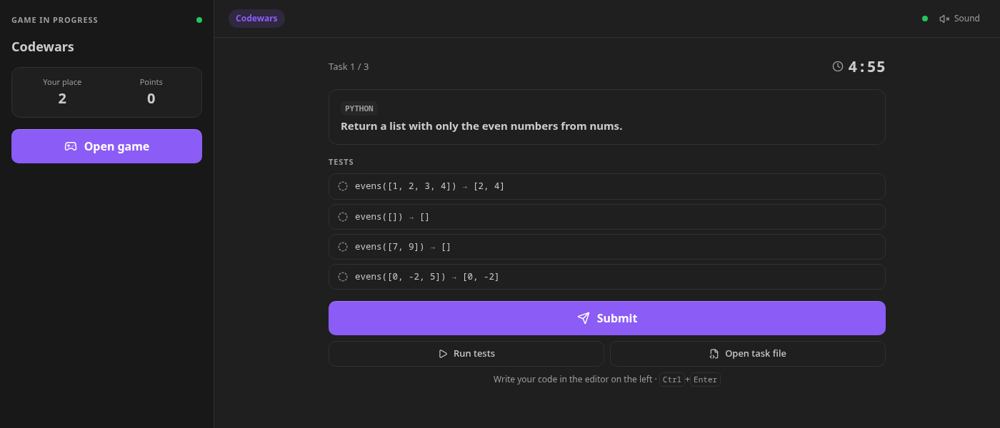
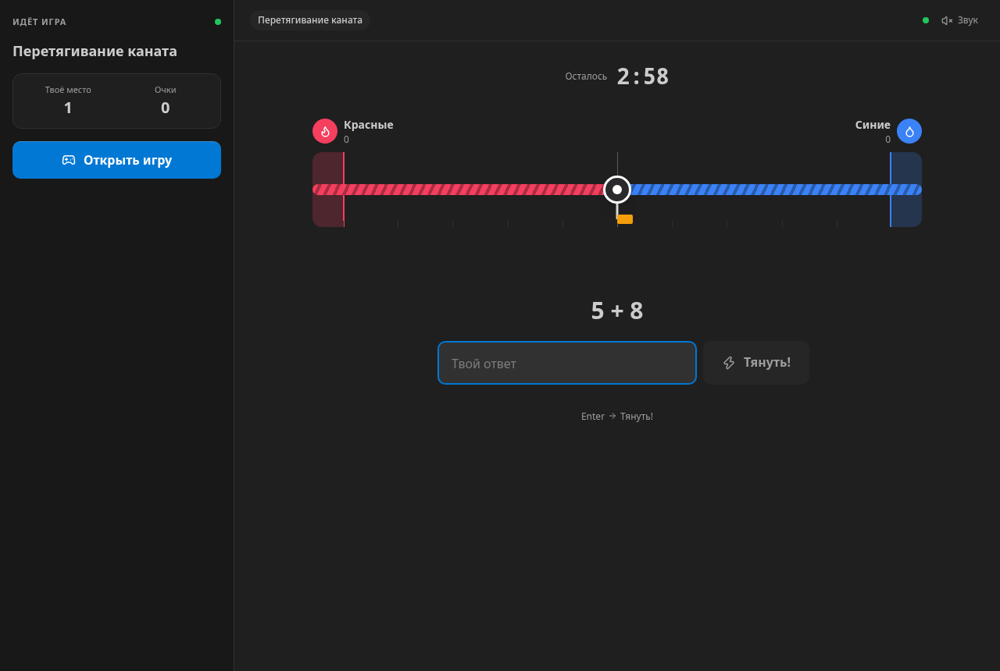

# CodeArena — coding games for class

**Kahoot + Codewars inside VS Code.** Run your programming lesson in the editor your students already use:
see who is done and who is stuck, show your code live, and switch to a coding game in one click.

Free and open source. No accounts for students — a 6-digit code or a link is enough.



## Lesson mode

The room opens in **Lesson** mode:

- Students mark **Done / Still writing / Lost** from the sidebar, from the small menu of the CodeArena
  icon at the bottom right (click or hover it), or with `Ctrl+Alt+1…3`, and can ask **«Explain again»**
  anonymously — you only see the count.
- **Hints on a line**: open a student's code, put the cursor on a line and press 💬 — the student sees
  your hint right next to that line. It disappears when they fix it.
- **Watch from your phone**: «From phone» in the teacher panel shows a QR code — scan it and follow the
  class live in the phone browser: who is writing, done or stuck, progress, and each student's code. View only.
- **Show your file**: students get your code next to theirs, read-only, and can follow your cursor.
- **Checkpoints**: your current code becomes the reference for the step; each student's progress
  is computed from their own file (whitespace and blank lines don't matter).
- «Done 7 of 24», students who are behind on top, click anyone to see their code.

## Games

Start a game on top of the lesson — everyone returns to the lesson when it ends.

| Game | What students do |
|---|---|
| 🎯 **Quiz** | Questions with 2–4 colored options, faster = more points |
| 🪢 **Tug of war** | Two teams answer short questions; every right answer pulls the rope |
| 🥋 **Codewars** | Write a function or markup in the editor; tests run on the student's computer |
| 🏁 **Race** | A series of tasks — first to the finish wins |
| 🐞 **Find the bug** | Click the buggy line, fix broken code or pick the better variant |







Tasks in **HTML/CSS**, **JavaScript**, **Python** and **Dart** (HTML/CSS is checked with selector and CSS rules).
A built-in task bank has about 470 tasks in two levels — basic and medium, with tricky «what will this print?» questions.

## Your own tasks and AI

- **Import** a JSON, text or **Word** file, or **paste** questions — every task goes to the game it fits
  (options → Quiz, short answer → Tug of war, code → Codewars, bugs → Find the bug).
- **Generate with AI** using your own free [Gemini key](https://aistudio.google.com/apikey).
  Code tasks are verified before the lesson: the reference solution must pass, the starter must not.

Simple text format:

```text
1. Which tag creates a link?
- <div>
+ <a>

2. Which property sets the text color?
= color
```

## Fair play

Optional anti-cheat for games: paste guard in task files, focus tracking, a check for AI extensions,
plus a live table and CSV export for the teacher. Everything is off in Lesson mode.

## How to start

1. **Teacher**: open the CodeArena view in the Activity Bar → *I'm a teacher — create a room*.
2. Send the link or the 6-digit code to the class chat.
3. **Students**: CodeArena view → enter the code and their name → *Join*.

Python tasks need Python 3 on the student's computer, Dart tasks need the Dart SDK (or Flutter);
JavaScript and HTML/CSS need nothing.

## Privacy

Students only enter a display name. Student code runs locally; the server only relays game messages
and forgets a room 6 hours after it goes quiet. The Gemini key is stored in VS Code's secret storage
and sent only to Google's API. Schools can [host their own server](https://github.com/q-werty452/codearena#self-hosting).

## По-русски

CodeArena — уроки и игры по программированию прямо в VS Code: режим урока (статусы учеников, показ кода,
чекпоинты с процентом), викторина, перетягивание каната, Codewars, гонка и «Найди баг». Банк из ~470 заданий по HTML/CSS,
JavaScript, Python и Dart (базовый и средний уровень). Свои задания из файла или Word, генерация заданий с ИИ. Интерфейс на русском включается сам при русском VS Code.

## Author

Made by [**q-werty452**](https://github.com/q-werty452) · MIT license ·
[source code](https://github.com/q-werty452/codearena) · [report a problem](https://github.com/q-werty452/codearena/issues)
