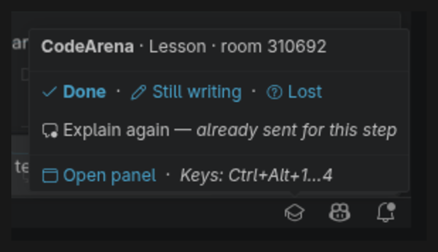
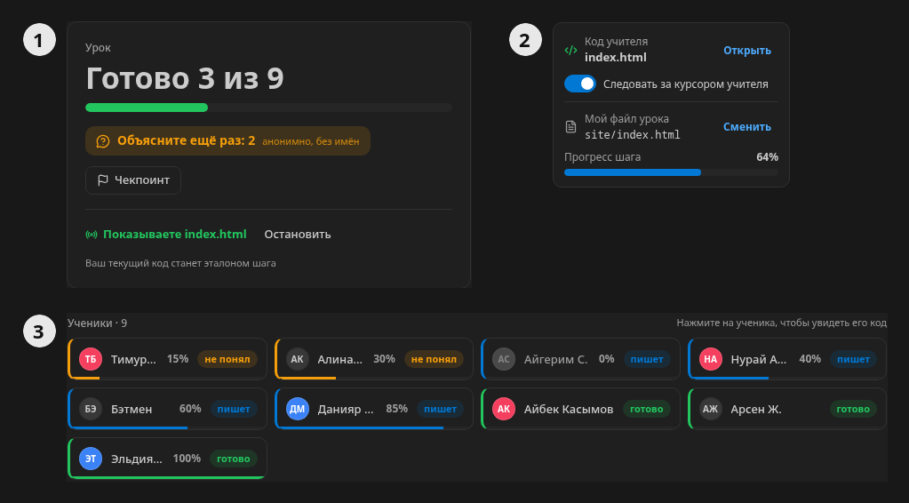
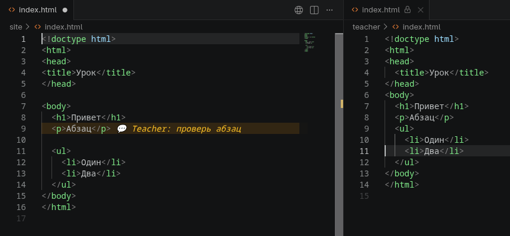
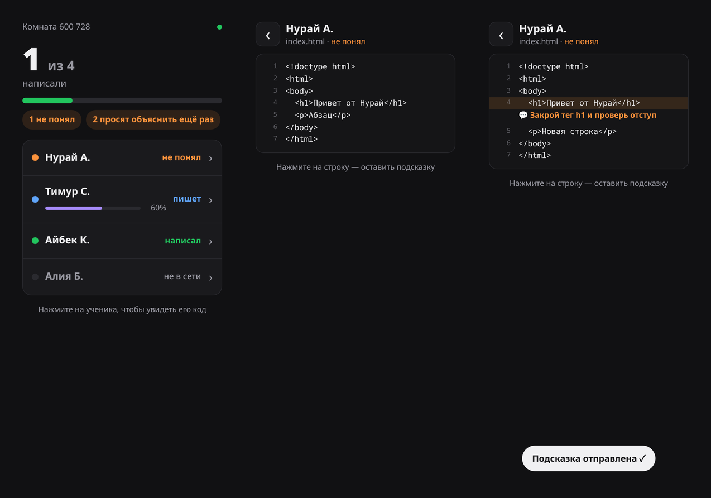

# CodeArena — уроки и игры по программированию в VS Code

Учитель ведёт урок прямо в редакторе, где пишут ученики. Видно, кто уже написал, а кто застрял.
Свой код можно показать всем, у любого ученика открыть его код и подсказать на нужной строке.
А когда класс устал — за минуту запустить игру: викторину, перетягивание каната или Codewars.

Бесплатно и с открытым кодом. Ученикам не нужны аккаунты — только код комнаты.


*[English below](#in-english)*

## Зачем это

| Было на уроке | С CodeArena |
|---|---|
| Ходите по рядам и спрашиваете «кто уже написал?» | Статусы и проценты всех учеников у вас на экране |
| Застрявший молчит — стесняется спросить | Кнопка «Объясните ещё раз» анонимная, вы видите только сколько |
| Не успевают переписывать с проектора | Ваш код открыт у каждого рядом с его файлом и прокручивается за вашим курсором |
| Проверяете код по одному | Тесты запускаются у ученика сами, результат приходит вам |
| К середине пары внимание падает | Игра на 5–10 минут на тех же темах — и обратно к уроку |
| Вышли из класса — не знаете, что там | Весь класс и код каждого видно с телефона |

## Как начать — 2 минуты

**Учитель**
1. Установите CodeArena и нажмите её значок слева, на панели действий VS Code.
2. **«Я учитель — создать комнату»**.
3. **«Скопировать ссылку»** и отправьте её в группу класса.

**Ученик**
1. Установите CodeArena — аккаунт не нужен.
2. Откройте ссылку от учителя или введите код комнаты и имя → **«Войти»**.

Для заданий на Python у ученика должен быть установлен Python 3, на Dart — Dart SDK или Flutter.
Для HTML, CSS и JavaScript ничего ставить не надо.

## Урок

### Статусы учеников

Ученик отмечает, как у него дела: **Готово**, **Ещё пишу** или **Не понял**. Это можно сделать тремя способами:

- в боковой панели CodeArena;
- в значке 🎓 справа внизу — по клику или наведению;
- клавишами `Ctrl+Alt+1`, `2`, `3`, а `Ctrl+Alt+4` — анонимное «Объясните ещё раз».



### Показать свой код

Откройте файл и нажмите **«Показать текущий файл»** в панели учителя. У каждого ученика он откроется рядом с его кодом,
только для чтения. Включённое **«Следовать за курсором учителя»** прокручивает его за вами.

### Чекпоинт — кто успевает за вами

Чекпоинт отвечает на вопрос «сколько класс уже переписал». Пример: вы вместе с группой верстаете `index.html`.

1. Покажите свой `index.html` и пишите код, а класс повторяет у себя.
2. Закончили кусок — нажмите **«Чекпоинт»** (в панели учителя или значок флажка над редактором).
   Ваш код в этот момент становится **эталоном шага**.
3. У каждого ученика расширение само находит его `index.html` и считает, насколько код совпадает с эталоном —
   ученик видит **«Прогресс шага 64%»**. Отступы и пустые строки не важны.
4. У вас в списке учеников — проценты всех. Кто дошёл до 100%, сам становится «готово», отстающие стоят сверху.
5. Следующий кусок — снова «Чекпоинт»: статусы и счётчик «Объясните ещё раз» начинаются заново.



### Посмотреть код ученика и подсказать

Нажмите на ученика в списке — его файл откроется рядом с вашим. Поставьте курсор на строку и нажмите 💬
над редактором: напишите коротко, например «тут не закрыт тег». У ученика эта строка подсветится с вашим текстом.
Исправит строку — подсказка исчезнет сама. Код ученика вы не меняете — он исправляет сам.



### Смотреть с телефона

Нажмите **«С телефона»** в панели учителя и наведите камеру на QR-код. На телефоне видно, кто пишет, кто написал
и кто застрял, а нажав на ученика — его код, который обновляется сам. Нажмите на строку — и отправьте подсказку прямо с телефона.
Ссылку не отправляйте ученикам: по ней виден весь класс.



## Игры

**«Начать игру»** → выберите игру → возьмите задания из банка, свои или создайте с ИИ → **«Начать»**.
У учеников игра открывается сама, а после итогов все возвращаются к уроку.

| Игра | Что делают ученики |
|---|---|
| **Викторина** | Вопрос и 2–4 цветных варианта: чем быстрее правильный ответ, тем больше очков |
| **Перетягивание каната** | Две команды отвечают на короткие вопросы — каждый правильный ответ тянет канат к своей |
| **Codewars** | Пишут функцию или вёрстку в редакторе, тесты проверяют сами; короткое решение выше |
| **Гонка** | У каждого своя цепочка заданий — кто первым дойдёт до финиша |
| **Найди баг** | Находят строку с ошибкой, чинят сломанный код или выбирают лучший вариант |


## Задания

**Банк — 737 готовых заданий** по HTML/CSS, JavaScript, Python и Dart: базовый и средний уровень по каждому языку,
для HTML/CSS ещё и сложный. В редакторе игры — кнопка **«Из банка»**.

**Свои задания** — в «Мои задания»:

- **Загрузить файл** — JSON, текст или Word;
- **Вставить текст** — скопировать вопросы откуда угодно;
- **Создать с ИИ** — по теме или конспекту, с вашим бесплатным [ключом Gemini](https://aistudio.google.com/apikey).
  Задачи с кодом проверяются до урока: эталон проходит тесты, заготовка — нет.

Задания сами раскладываются по играм: вопрос с вариантами → викторина, короткий ответ → канат,
код с тестами → Codewars, «найди строку», «исправь» и «выбери лучший» → «Найди баг».

Простой текстовый формат — «+» у правильного варианта, «=» у короткого ответа:

```text
# Тема: HTML
1. Какой тег создаёт ссылку?
- <div>
+ <a>
- <span>

2. Каким свойством меняют цвет текста?
= color
```

## Честная игра

Во время игр можно включить защиту: запрет вставки длинного текста в файл задачи, уход из окна,
проверка ИИ-расширений, живая таблица и выгрузка в CSV. На уроке всё это выключено.

## Конфиденциальность

Ученики вводят только имя. Код учеников запускается у них на компьютере, сервер лишь пересылает сообщения игры
и забывает комнату через 6 часов тишины. Ключ Gemini хранится в защищённом хранилище VS Code и уходит только в Google.
Колледж может [поднять свой сервер](https://github.com/q-werty452/codearena#self-hosting).

---

## In English

**CodeArena runs programming lessons and class games right in VS Code.** The teacher sees who is done, writing or stuck,
shows their code next to every student's file, opens any student's code and leaves a hint on a line, follows the class
from a phone, and starts a quick game — quiz, tug of war, Codewars, race or find the bug. Free and open source;
students need no account, only a 6-digit room code. The interface switches to English or Russian with VS Code.

**Start:** CodeArena icon in the Activity Bar → *I'm a teacher — create a room* → copy the link to the class chat.
Students open the link (or enter the code and their name) → *Join*.

**Checkpoint, in short:** show your file, code along with the class, then press **Checkpoint** — your code becomes the
reference for this step. Each student's own file with the same name is compared to it (indentation and blank lines
don't matter), so every student sees their percentage and you see everyone's; 100% marks them done.

**Hints:** click a student to open their code, put the cursor on a line, press 💬 and type — the line lights up for the
student with your text and clears when they fix it. **From phone:** scan the QR code in the teacher panel.

**Tasks:** 737 in the built-in bank (HTML/CSS, JavaScript, Python, Dart), your own from JSON, text or Word,
or generated with your free Gemini key. Python tasks need Python 3, Dart tasks need the Dart SDK or Flutter.

## Автор · Author

[**q-werty452**](https://github.com/q-werty452) · MIT · [исходный код / source](https://github.com/q-werty452/codearena) ·
[сообщить о проблеме / report a problem](https://github.com/q-werty452/codearena/issues)
